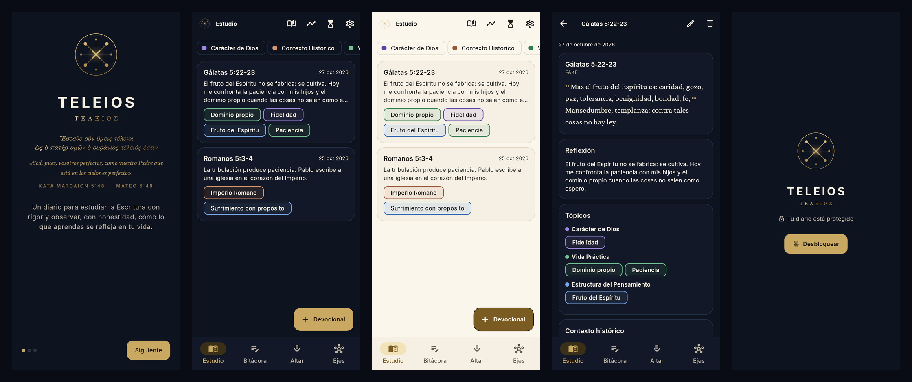
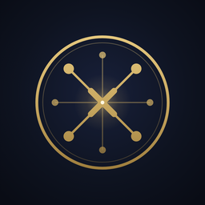

# Guía de marca — TELEIOS

## Marca

Círculo con la **Chi (Χ)** dorada —inicial de Χριστός— y el lema de Mateo 5:48:

> Ἔσεσθε οὖν ὑμεῖς τέλειοι ὡς ὁ πατὴρ ὑμῶν ὁ οὐράνιος τέλειός ἐστιν
> «Sed, pues, vosotros perfectos, como vuestro Padre que está en los cielos es perfecto»

| Archivo | Uso |
|---------|-----|
| `app/assets/brand/teleios-logo-vertical.svg` | Logo completo (fuente de verdad) |
| `app/assets/brand/teleios-mark.svg` | Marca dentro de la app (`TeleiosMark`) |
| `app/assets/brand/icon-*.png`, `splash-*.png` | Íconos y splash; se regeneran con `python tool/build_brand_assets.py` |

> **Corrección aplicada al SVG original:** el degradado dorado usaba `objectBoundingBox`; en líneas rectas (caja de ancho o alto cero) la especificación SVG manda no pintarlas, así que la Χ central no se veía en ningún navegador. El ícono ahora usa un degradado en coordenadas absolutas (`gold3i`). El diseño no cambió.

## Color

| Token | Hex | Uso |
|-------|-----|-----|
| Dorado claro | `#F0D48A` | Inicio del degradado, brillos |
| **Dorado** | `#C9A961` | Primario en modo oscuro |
| Dorado profundo | `#8C6B2E` | Final del degradado |
| Tinta dorada | `#7A5C22` | Primario en modo claro (contraste AA sobre pergamino) |
| **Medianoche** | `#0E1320` | Fondo oscuro, ícono, splash |
| Crema | `#F5EFE0` | Texto sobre medianoche |
| Pergamino | `#FAF6EC` | Fondo claro |

Dimensiones (tonos joya que conviven con el dorado):

| Dimensión | Claro | Oscuro |
|-----------|-------|--------|
| Carácter de Dios | `#5B45A8` | `#9D89E0` |
| Contexto Histórico | `#9A5636` | `#D9946B` |
| Vida Práctica | `#2F7D4E` | `#72C192` |
| Estructura del Pensamiento | `#2B64B5` | `#79AAEB` |

Fuente de verdad en código: `app/lib/core/theme/brand.dart` y `app_theme.dart`.

## Tipografía

| Familia | Uso | Licencia |
|---------|-----|----------|
| **Inter** | Interfaz y wordmark `TELEIOS` | OFL |
| **Crimson Pro** | Texto bíblico y citas (`context.scripture.body`) | OFL |
| **GFS Didot** | Griego (`ΤΕΛΕΙΟΣ`, lema) | OFL |

Empaquetadas en `app/assets/fonts/` (no se descargan en tiempo de ejecución, por privacidad y uso sin conexión).

## Ícono

- Los íconos usan un **ajuste óptico**: trazos más gruesos que el logo para que se lean a 32–48 px.
- Android: ícono adaptativo (fondo medianoche + marca) e ícono temático monocromo (Android 13+).
- iOS: sin transparencia, fondo medianoche.
